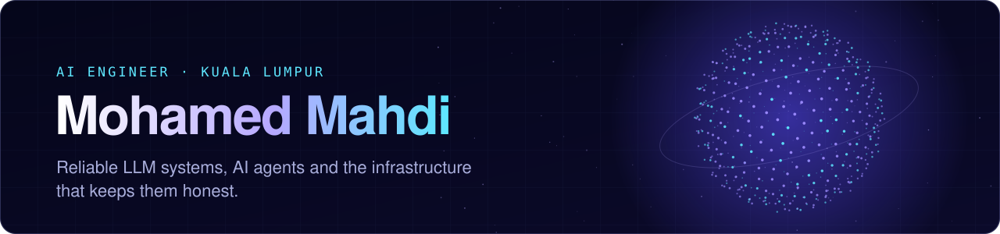

  
  
  

I'm an AI engineer in Kuala Lumpur. I build AI systems that are reliable, measurable and safe to
put in front of real decisions: policy enforced in the backend rather than the prompt, evaluations
tied to recorded evidence, and systems that fail safely.

Before that I spent two years building LLM-powered features for a school wellbeing platform used by
3 schools, including automated reports that cut preparation from 10+ hours to under an hour. I'm now doing a Master's in
Computing and Informatics at Multimedia University and **open to AI engineering roles**.

### Featured project

<table>
<tr>
<td width="52%" valign="top">

**[AgentOps Control Plane](https://github.com/MohamedMahdiCS/agentops-control-plane)**

Run, govern and evaluate AI agents with every number backed by recorded evidence.

- Default-deny tool gateway with action-scoped human approvals
- Crash-safe runs on a PostgreSQL queue with leases and fencing
- Deterministic 0–100 grading, replayable benchmarks and CI release gates
- React and Three.js operator console

[Live demo](https://mohamedmahdics.github.io/agentops-control-plane/) ·
[Case study](https://mohamedmahdics.github.io/agentops/) ·
[Code](https://github.com/MohamedMahdiCS/agentops-control-plane)

</td>
<td width="48%" valign="top">

</td>
</tr>
</table>

**In progress:** an evidence-first AI claims adjuster that reads messy insurance documents in
English, Malay and Chinese, resists tampering and prompt injection, and runs fully on a laptop with
open models, along with a public benchmark to measure it.

### Toolbox

  
  
  
  
  
  
  
  

LLM applications · AI agents · model evaluation · guardrails · human-in-the-loop · system design
